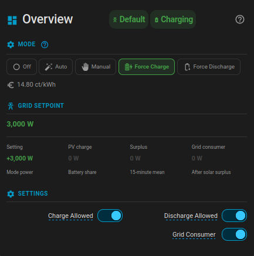

<p align="center">
  
</p>

<h1 align="center">Victron Charge Controller for Home Assistant</h1>

<p align="center">
  <a href="https://github.com/hacs/integration"></a>
  <a href="https://github.com/johannesWen/Victron-Charge-Controller/releases"></a>
  <a href="https://github.com/johannesWen/Victron-Charge-Controller/actions/workflows/ci.yml"></a>
  <a href="https://github.com/johannesWen/Victron-Charge-Controller/blob/main/LICENSE"></a>
  <a href="https://ko-fi.com/yoschi777"></a>
</p>

Victron Charge Controller schedules battery charging and discharging in Home Assistant.
It uses EPEX Spot prices to charge during cheap hours and discharge during expensive hours.
You can also set a schedule or control your Victron ESS from a dashboard or automation.

## Contents

- [Capabilities](#capabilities)
- [Requirements](#requirements)
- [Installation](#installation)
- [Setup](#setup)
- [Dashboard Card](#dashboard-card)
- [Grid Consumer](#grid-consumer)
- [Battery And Solar Control](#battery-and-solar-control)
- [Entity Reference](#entity-reference)
- [Services](#services)
- [Defaults](#defaults)
- [Setpoint Convention](#setpoint-convention)
- [Fixed Plans](#fixed-plans)
- [Cost And Energy Tracking](#cost-and-energy-tracking)
- [Development](#development)

## Capabilities

The controller can:

- Choose charge and discharge hours automatically from electricity prices.
- Edit hours for today and tomorrow, or save a daily fixed plan.
- Start charging or discharging with force modes.
- Apply battery charge limits and grid power limits.
- Use spare solar power for charging and export.
- Reduce grid export when prices fall below your chosen limit.
- Account for a large load, such as an electric vehicle charger, with Grid Consumer.
- View Solcast forecasts and track grid energy costs.

Configuration, energy counters, and schedules survive Home Assistant restarts.
Restarting in Auto mode does not replace your saved schedule.

## Requirements

| Component | Purpose |
| --- | --- |
| Home Assistant | Runs the integration and dashboard. |
| Victron GX (Built-in) | Provides battery data and writable power controls. |
| [EPEX Spot](https://github.com/mampfes/ha_epex_spot) | Provides hourly electricity prices for today and tomorrow. |

## Installation

[](https://my.home-assistant.io/redirect/hacs_repository/?owner=johannesWen&repository=Victron-Charge-Controller&category=integration)

To install with HACS:

1. Search for Victron Charge Control in HACS and install it.
2. Restart Home Assistant.
3. Go to Settings → Devices & Services → Add Integration.
4. Search for Victron Charge Control.
5. Select the entities listed below.

## Setup

An entity is a Home Assistant sensor or control.
SOC means battery state of charge, as a percentage.
A setpoint is the power target sent to Victron.
RAM is temporary memory.
PV means power from solar panels.

Select these entities during setup. Leave optional fields empty if you do not use them.

| Field | Required | Purpose or example entity |
| --- | --- | --- |
| Battery SOC sensor | Yes | Battery charge percentage. Example: GX Device - DC battery charge. |
| AC power setpoint | Yes | Permanent idle target in watts. Example: GX Device - AC power setpoint. |
| AC grid setpoint | Yes | Temporary target in watts, stored in RAM. Example: GX Device - AC grid setpoint. |
| EPEX Spot price sensor | Yes | Hourly prices. Example: EPEX Spot Data - Market Price. |
| Max grid feed-in entity | Yes | Writable export limit in watts. Example: GX Device - ESS max feed-in power. |
| Grid consumption energy sensor | No | Total grid import in kWh, for cost tracking. |
| Grid feed-in energy sensor | No | Total grid export in kWh, for revenue tracking. |
| Grid consumer power sensor | No | Load in W or kW, such as an electric vehicle charger. See [Grid Consumer](#grid-consumer). |
| Solar surplus sensor | No | Spare solar power in watts, for solar charging and export. |
| DC coupled PV feed in switch | No | Controls DC solar export in reduced feed-in mode. Example: GX Device - DC-coupled PV - feed in excess. |

Select different writable number entities for AC power setpoint and AC grid setpoint.
You can change entity selections under Settings → Devices & Services → Victron Charge Control → Configure.
No YAML configuration is needed.

### Upgrade from a version before v2.2.1

The controller cannot start until you select the additional AC grid setpoint entity.
Your existing schedules and configuration remain saved.
To update the configuration:

1. Open Settings → Devices & Services → Victron Charge Control.
2. Open the integration entry menu and select Reconfigure.
3. Keep the existing AC power setpoint selection.
4. Select GX Device - AC grid setpoint for AC grid setpoint.
5. Save the configuration. Home Assistant reloads the integration and retries setup.

### Power targets and connection faults

The permanent AC power setpoint stays at Idle Setpoint.
Active targets use the temporary AC grid setpoint in RAM, refreshed every five seconds.
This includes Grid Consumer adjustments during an Idle action.
Off and safety stops send Idle Setpoint to RAM and stop active refreshes.
The controller retries failed idle writes and attempts an idle reset when the integration unloads.

Setpoint Deadband ignores small changes during normal power updates.
The five-second refresh and safety corrections bypass this limit.
Do not rely on a fixed return time to the permanent target after a connection loss.

Safety watchdog grace period gives sensors time to become available after startup or reload.
It defaults to 90 seconds, accepts 0–600 seconds, and ends early when the required readings are ready.
Set it to `0` to disable this delay.

After this period, missing or unavailable battery SOC or setpoint entities trigger a safety stop and notification.
Unknown SOC or permanent setpoint values also trigger a stop.
An inactive RAM value can be `unknown` and still accept writes.
The notification identifies the failed entities and explains how to resume control.

### Optional Solcast forecast

If [Solcast PV Solar Forecast](https://github.com/BJReplay/ha-solcast-solar) is installed, the controller finds it automatically.
Use Solcast forecast is enabled by default.
You can turn it off under Settings → Devices & Services → Victron Charge Control → Configure.
No extra API key or entity selection is needed.

The controller reads forecasts for today and tomorrow from the local Solcast cache every five minutes.
It makes no extra cloud requests.
Forecasts appear in the Plan card but do not change charging decisions or saved schedules.

Use these sensors to find forecast problems:

| Sensor | Meaning |
| --- | --- |
| Solar Forecast Status | Whether the forecast is ready. See the states below. |
| Solar Forecast Last Updated | The timestamp from Solcast, not the last controller update. |
| Solar Forecast Coverage | Hours of continuous forecast data from now, up to the end of tomorrow. |

| Status | Meaning or action |
| --- | --- |
| `disabled` | Turn on Use Solcast forecast to read forecasts. |
| `not_detected` | If you want forecasts, install and configure Solcast. |
| `unavailable` | Make sure that Solcast loads and provides cached forecasts and an update timestamp. |
| `invalid_data` | Solcast returned invalid forecast data. Make sure that the installed versions are compatible. |
| `incomplete` | Forecast data has gaps before the end of tomorrow. |
| `stale` | The Solcast timestamp is older than 36 hours. Review its update configuration. |
| `ready` | Forecast data covers the remaining time through tomorrow and is no older than 36 hours. |

Forecast failures disable the PV forecast view. They do not trigger the battery safety stop.

## Dashboard Card

The integration loads the dashboard card automatically.
No manual Lovelace resource entry is needed.
In the dashboard editor, select Add Card and search for Victron Charge Controller.

You can also use YAML:

```yaml
type: custom:victron-charge-controller-card
title: Victron Charge Control
entity_prefix: victron_charge_control
view: settings
```

Choose a view in the card editor or with the `view` field:

| View | Purpose |
| --- | --- |
| `overview` | Select the control mode, allow charging or discharging, and see the grid target calculation. |
| `settings` | Adjust power limits, price limits, and other controls. This is the default view. |
| `plan` | View prices, edit the schedule for today and tomorrow, and manage fixed plans. |
| `history` | View grid cost, revenue, import, and export by day, week, month, or year. |

Overview and Settings show how mode power, solar power, and Grid Consumer contribute to the grid target.
When a limit caps the target, the original result appears in parentheses, such as `5,000 W (6,000 W)`.

In the Plan card, switch from Price to PV forecast to view expected solar production.
The chart shows the main Solcast forecast and a lower estimate, alongside hourly electricity prices.
It uses the Home Assistant time zone.

To view or edit a time slot:

- Hover, tap, or focus the slot to see its values.
- Right-click or hold a current or future hour with a price to choose Charge, PV, Discharge, or Idle.
- With a keyboard, focus the slot and press Enter or Space.

Hours without prices are read-only. Switch back to Price to edit price limits.
If Solcast data becomes unusable, the card returns to Price.

| Plan | History |
| :---: | :---: |
|  |  |

| Settings | Overview |
| :---: | :---: |
|  |  |

## Grid Consumer

Grid Consumer adjusts the power target for a load such as an electric vehicle charger.
Use a sensor for a load already included in Victron ESS consumption.
For several loads, select a sensor that reports their total power.

To enable it:

1. Open the integration configuration.
2. Select Grid consumer power sensor.
3. Turn on Grid Consumer under Settings → Auto Mode in the card.

Grid Consumer defaults to off and remembers its state after a restart.
It works in Auto, Manual, Force Charge, and Force Discharge, including Idle and PV Charge actions.
It does not apply in Off mode.

The controller subtracts current solar surplus from the load and adds any remaining demand to the grid target.
It then applies grid and feed-in limits.
Without a valid solar reading, it adds the full load.
With an invalid consumer reading, it removes the adjustment and shows a warning.

For example, a `3,000 W` load with `2,000 W` of solar surplus adds `1,000 W` to the target.
Without solar surplus, a `3,000 W` charging target plus a `3,000 W` load requests `6,000 W`.
The default Max Grid Setpoint caps this at `5,000 W`.
A `−2,000 W` discharge target plus a `3,000 W` load requests `1,000 W` of import before limits.

Load changes take effect after a fixed five-second delay.
Later readings update the value without restarting the delay.
Turning Grid Consumer off, selecting Off mode, or losing a valid load reading removes the adjustment without this delay.

Grid Consumer changes the requested power target. It does not guarantee that the battery will not supply the load.

## Battery And Solar Control

SOC Hysteresis is a buffer that prevents rapid switching at battery limits.
Charging stops at Max SOC and resumes below `Max SOC − SOC Hysteresis`.
Without a solar surplus sensor, discharge stops at Min SOC and resumes above `Min SOC + SOC Hysteresis`.

With a solar surplus sensor, the discharge target includes the average spare solar power over 15 minutes.
Battery protection follows these limits:

| Battery level | Discharge behavior |
| --- | --- |
| Falls to Min SOC | Switch from full discharge to solar-only export. |
| Falls to `max(0, Min SOC − SOC Hysteresis)` or below | Apply Idle Setpoint on the next control update without the normal action delay. |
| Recovers to Min SOC | Resume solar-only export. |
| Rises above `Min SOC + SOC Hysteresis` | Resume full discharge, which can continue down to Min SOC. |

At startup, discharge stays stopped below Min SOC.
With a solar sensor, it starts with solar-only export between Min SOC and the upper limit.
Full discharge starts only above that limit.
With zero hysteresis, discharge stops at or below Min SOC and resumes above it.

The solar average can exceed the power currently available and draw from the battery.
The lower cutoff limits this behavior.
Stopping applies Idle Setpoint. It does not stop other battery activity controlled by Victron.

PV charging shares solar surplus between the battery and grid export.
PV Charging Battery Share sets the battery portion: `100` keeps all surplus, and `0` exports it all.
Grid and feed-in limits still apply.
PV charging requires a solar surplus sensor and follows the maximum SOC limit.
It does not depend on Charge Allowed or blocked charging hours.
Grid Consumer can request grid import during PV Charge or Idle.

## Entity Reference

| Entity | Platform | Description |
| --- | --- | --- |
| Control Mode | Select | `off`, `auto`, `manual`, `force_charge`, or `force_discharge`. |
| Charge Allowed | Switch | Allow charging from the grid. Does not control PV charging. |
| Discharge Allowed | Switch | Allow discharging. |
| Grid Consumer | Switch | Enable the load adjustment described in [Grid Consumer](#grid-consumer). |
| Grid Feed-in Control Enabled | Switch | Enables price-based grid feed-in limiting. |
| Min SOC | Number | Minimum battery charge level. |
| Max SOC | Number | Maximum battery charge level. |
| SOC Hysteresis | Number | Buffer before charging or discharging resumes at a battery limit. |
| Charge Power | Number | Target import power while charging. |
| Discharge Power | Number | Target export power while discharging. |
| PV Charging Battery Share | Number | Percentage of spare solar power sent to the battery. |
| Idle Setpoint | Number | Grid setpoint used while idle. |
| Min Grid Setpoint | Number | Lowest allowed grid setpoint. |
| Max Grid Setpoint | Number | Highest allowed grid setpoint. |
| Setpoint Deadband | Number | Minimum change in watts for normal power updates. Set to `0` to disable. |
| Cheapest Hours | Number | Number of low-price hours selected for auto charge. |
| Expensive Hours | Number | Number of high-price hours selected for auto discharge. |
| Charge Price Threshold | Number | Maximum price for automatic charging. |
| Discharge Price Threshold | Number | Minimum price for automatic discharging. |
| Grid Feed-in Price Threshold | Number | Reduce feed-in when the price falls below this value. |
| Default Max Grid Feed-in | Number | Normal feed-in limit. |
| Reduced Max Grid Feed-in | Number | Export limit when prices are low. Also limits PV Charge and Discharge targets. |
| Blocked Charging Hours | Text | Comma-separated hours excluded from charging. |
| Blocked Discharging Hours | Text | Comma-separated hours excluded from discharging. |
| Active Fixed Plan | Select | Active plan number, or `off`. |
| Recalculate Schedule | Button | Rebuilds the schedule from current price data. |
| Desired Action | Sensor | Current computed action: charge, pv_charge, discharge, or idle. |
| Target Setpoint | Sensor | Current computed grid setpoint in watts. |
| Current Price | Sensor | Current EPEX Spot price. |
| Charge Hours | Sensor | Scheduled charging slots, with dates. |
| Discharge Hours | Sensor | Scheduled discharging slots, with dates. |
| PV Charge Hours | Sensor | Scheduled solar charging slots, with dates. |
| Blocked Charging Hours | Sensor | Active charging block list. |
| Blocked Discharging Hours | Sensor | Active discharging block list. |
| Charge Plan | Sensor | Full hour-by-hour plan for today and tomorrow. |
| Fixed Plans | Sensor | Number of saved plans. Attributes contain the plans and active plan number. |
| Last Schedule Update | Sensor | Timestamp of the last schedule calculation. |
| Grid Feed-in Status | Sensor | Current feed-in mode: default or reduced. |
| Grid Energy Cost | Sensor | Total grid energy cost in EUR, before fees and taxes. |
| Grid Energy Revenue | Sensor | Total grid energy revenue in EUR, before fees and taxes. |
| Grid Energy Import | Sensor | Total tracked grid import in kWh. |
| Grid Energy Export | Sensor | Total tracked grid export in kWh. |
| Solar Surplus Mean (15 min) | Sensor | Average spare solar power over 15 minutes, in watts. Requires a solar surplus sensor. |
| Solar Surplus Mode | Sensor | Battery protection stage: `normal`, `solar_only`, or `blocked`. Desired Action shows whether the controller requests discharge. |

## Services

| Service | Description |
| --- | --- |
| `victron_charge_control.toggle_hour` | Cycle an hour through `idle`, `charge`, `pv_charge`, `discharge`, `blocked`, and back to `idle`. |
| `victron_charge_control.set_hour_action` | Set an hour to `idle`, `charge`, `pv_charge`, `discharge`, or `blocked`. |
| `victron_charge_control.set_blocked_charging_hours` | Replace the list of charging-blocked hours. |
| `victron_charge_control.set_blocked_discharging_hours` | Replace the list of discharging-blocked hours. |
| `victron_charge_control.set_fixed_plan_hour` | Set a plan hour to `charge`, `pv_charge`, `discharge`, or `idle`. Creates the plan if needed. |
| `victron_charge_control.set_fixed_plan_name` | Set a plan name, up to 10 characters. Creates the plan if needed. An empty value clears the name. |
| `victron_charge_control.add_fixed_plan` | Create a new empty fixed plan. |
| `victron_charge_control.remove_fixed_plan` | Delete a fixed plan (deactivates it first when active). |
| `victron_charge_control.calculate_schedule` | Recalculate the automatic schedule from EPEX Spot prices. |
| `victron_charge_control.clear_schedule` | Clear scheduled and blocked hours. An active fixed plan still applies. |

## Defaults

Change these values through the dashboard or Home Assistant entities.

| Parameter | Default |
| --- | --- |
| Min SOC | 10% |
| Max SOC | 95% |
| SOC Hysteresis | 2% |
| Charge Power | 3000 W |
| Discharge Power | 3000 W |
| Idle Setpoint | 0 W |
| Min Grid Setpoint | -5000 W |
| Max Grid Setpoint | 5000 W |
| Setpoint Deadband | 200 W |
| Cheapest Hours | 4 |
| Expensive Hours | 4 |
| Charge Price Threshold | 10 ct/kWh |
| Discharge Price Threshold | 20 ct/kWh |
| Grid Feed-in Price Threshold | 0 ct/kWh |
| Default Max Grid Feed-in | 5000 W |
| Reduced Max Grid Feed-in | 0 W |
| Blocked Charging Hours | 18-23 |
| Blocked Discharging Hours | 15-17 |

## Setpoint Convention

| Setpoint | Meaning |
| --- | --- |
| Positive, for example `3000 W` | Request power from the grid. |
| Negative, for example `-3000 W` | Request power export to the grid. |
| `0 W` | Request zero net grid power. The battery can still supply local loads. |

## Fixed Plans

Fixed plans repeat the same charge, discharge, and PV-charge hours every day.
Use the second page of the Plan card to create, edit, rename, activate, or delete them.
You can save up to eight plans, with names up to ten characters long.
Only one plan can be active at a time.

The active plan adds hours to today and tomorrow and replaces automatic actions in the same hours.
It applies again after schedule recalculation or plan edits.
Turning it off restores the schedule from before activation.

Fixed plans also supply daily hours in Manual mode after the nightly schedule reset.
A manual change for one date lasts until the next recalculation applies the fixed plan again.

## Cost And Energy Tracking

For cost tracking, select energy sensors that report total grid import and export.
The integration tracks cost and revenue separately:

- Positive prices add grid consumption to cost and grid feed-in to revenue.
- Negative prices add grid consumption to revenue and grid feed-in to cost.
- Taxes, fixed fees, grid fees, and provider markups are not included.

## Development

### Build the bundled card

The card uses Lit and Rollup. Its source is in [`frontend/`](frontend/).
To build it from the repository root, run:

```bash
cd frontend
npm install
npm run build     # -> ../custom_components/victron_charge_control/static/victron-charge-controller-card.js
```

To rebuild the card when a source file changes, run from `frontend/`:

```bash
npm run watch
```

Git ignores the `static/` directory. The release build includes the card in `victron_charge_control.zip`.

### Local Home Assistant

Use the Docker Compose environment to test with dummy Victron and EPEX entities.
From the repository root, run:

```bash
cd frontend && npm install && npm run build && cd ..
docker compose up -d
```

Open <http://localhost:8123>.
For automatic dependency installation, use Dev Containers: Reopen in Container in VS Code.
See [dev/README.md](dev/README.md) for setup, Solcast test data, and sample cost history.
