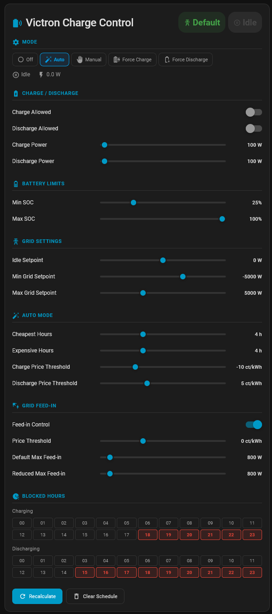
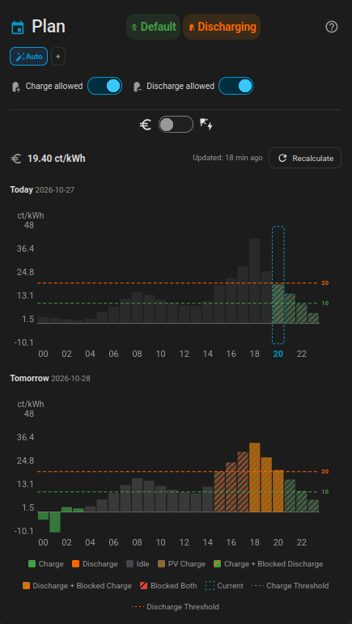
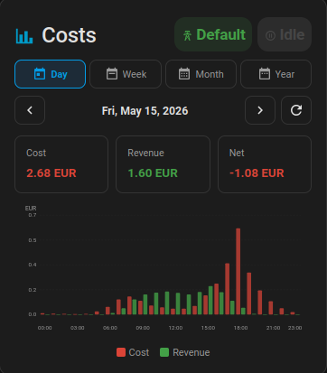

<p align="center">
  
</p>

<h1 align="center">Victron Charge Controller for Home Assistant</h1>

<p align="center">
  <strong>Automated Victron ESS charge and discharge control using EPEX Spot day-ahead prices.</strong>
</p>

<p align="center">
  <a href="https://github.com/hacs/integration"></a>
  <a href="https://github.com/johannesWen/Victron-Charge-Controller/releases"></a>
  <a href="https://github.com/johannesWen/Victron-Charge-Controller/actions/workflows/ci.yml"></a>
  <a href="https://github.com/johannesWen/Victron-Charge-Controller/blob/main/LICENSE"></a>
  <a href="https://ko-fi.com/yoschi777"></a>
  <!--  -->
</p>

Victron Charge Controller is a Home Assistant custom integration for scheduling
Victron ESS battery charging and discharging around hourly energy prices. It reads
your battery SOC, EPEX Spot prices, and writable Victron grid setpoint entities,
then publishes Home Assistant controls, sensors, buttons, and services for operating
the system from dashboards or automations.

## Contents

- [Capabilities](#capabilities)
- [Dashboard Card](#dashboard-card)
- [Requirements](#requirements)
- [Installation](#installation)
- [Setup](#setup)
- [Entity Reference](#entity-reference)
- [Services](#services)
- [Defaults](#defaults)
- [Setpoint Convention](#setpoint-convention)
- [Fixed Plans](#fixed-plans)
- [Cost And Energy Tracking](#cost-and-energy-tracking)
- [Home Assistant Entities](#home-assistant-entities)
- [Development](#development)

## Capabilities

- **Automatic scheduling** selects the cheapest hours for charging and the most expensive hours for discharging.
- **Manual scheduling** allows individual hourly actions for today and tomorrow.
- **Fixed plans** store one or more recurring 24-hour patterns of charge, discharge, and PV-charge hours. Activating a plan merges its hours into the auto-planned schedule every day (today + tomorrow): fixed hours are added and win over the auto plan in the same hour. Only one plan can be active at a time, and deactivating restores the previous plan.
- **Force modes** immediately apply the configured charge or discharge power.
- **SOC protection** respects minimum and maximum battery limits, including hysteresis.
- **Grid setpoint limits** clamp generated setpoints to configured safe boundaries.
- **Solar-surplus-aware discharge** adds the 15-minute sliding mean of an optional solar surplus sensor to the discharge setpoint. Full discharge switches to surplus-only export at Min SOC. At or below `max(0, Min SOC − SOC Hysteresis)`, discharge stops and the configured Idle Setpoint is applied immediately on the next control update, without the action confirmation delay. Surplus-only export resumes at Min SOC; full discharge resumes strictly above Min SOC + SOC Hysteresis and then continues down to Min SOC again. The averaged surplus can temporarily exceed available solar power and draw from the battery, which is why the lower cutoff is needed. Without the sensor, discharge stops at Min SOC and resumes strictly above Min SOC + SOC Hysteresis.
- **Conservative discharge startup** starts stopped below Min SOC, surplus-only from Min SOC through Min SOC + SOC Hysteresis, and at full discharge above that upper threshold. Without a surplus sensor it stays stopped until the upper threshold is exceeded. With zero hysteresis, discharge stops at or below Min SOC and can run at full power above it. Stopping uses the configured Idle Setpoint; it does not disable other battery flows managed by Victron.
- **PV charging** charges the battery from solar surplus without importing from the grid, splitting surplus between battery and export according to a configurable share. PV charging is independent of the **Charge Allowed** switch and of blocked charging hours — it never draws from the grid, so it can stay active even when grid charging is disabled.
- **Feed-in management** reduces the configured max feed-in limit when prices fall below a threshold.
- **Restored state** keeps configuration, cost, and energy counters across Home Assistant restarts. The full charge/discharge plan (charge/discharge/pv_charge slots, blocked hours, last update) is also persisted and reloaded on restart — and a restart in auto mode does **not** trigger a replan, so the plan you set up the night before survives HA reboots untouched.
- **Service API** exposes schedule manipulation for dashboards, scripts, and automations.

## Requirements

| Component | Purpose |
| --- | --- |
| Home Assistant | Runs the custom integration and exposes entities/services. |
| [Victron Venus MQTT](https://github.com/tomer-w/ha-victron-mqtt) | Provides battery SOC, writable ESS grid setpoint and Victron telemetry. |
| [EPEX Spot](https://github.com/mampfes/ha_epex_spot) | Provides hourly day-ahead electricity prices. |

The config flow requires a battery SOC sensor, writable grid setpoint number, EPEX Spot price sensor, and writable max grid feed-in number. Grid import/export energy sensors are optional and enable cost and energy tracking.

## Installation

### HACS

[](https://my.home-assistant.io/redirect/hacs_repository/?owner=johannesWen&repository=Victron-Charge-Controller&category=integration)

1. Search for **Victron Charge Control** in HACS and install it.
2. Restart Home Assistant after installation completes.
3. Go to **Settings** > **Devices & Services** > **Add Integration** and search for **Victron Charge Control**.
4. Complete the setup flow.

## Setup

During setup, select the entities that connect this integration to your Victron and price data:

| Field | Required | Description | HA Entity |
| --- | --- | --- | --- |
| Battery SOC sensor | Yes | Battery state of charge in percent. | GX Device - DC battery charge |
| Grid setpoint entity | Yes | Writable ESS grid setpoint in watts. | GX Device - AC power setpoint |
| EPEX Spot price sensor | Yes | Hourly electricity price data. | EPEX Spot Data - Market Price |
| Max grid feed-in entity | Yes | Writable max grid feed-in limit in watts. | GX Device - ESS max feed-in power |
| Grid consumption energy sensor | No | Cumulative grid import meter in kWh. | - |
| Grid feed-in energy sensor | No | Cumulative grid export/feed-in meter in kWh. | - |
| Solar surplus sensor | No | Current solar surplus in watts. When configured, the discharge setpoint is `-(discharge_power + 15-min mean of this value)`, clamped to the grid setpoint limits. The same sensor also enables PV charging, which splits solar surplus between battery and grid export, and lets the discharge degrade to a solar-only export at Min SOC instead of stopping. | - |
| DC coupled PV feed in switch | No | Control the DC coupled PV feed in when in reduced mode. | GX Device - DC-coupled PV - feed in excess |

You can change these entities later from the integration options flow.

The options flow also provides a **Safety watchdog grace period** (default
90 seconds, configurable from 0–600 seconds). During this startup window,
missing, unknown, or unavailable battery SOC and grid setpoint entities do not
switch the restored control mode to OFF. Grace ends early once both entities
report real states. After grace ends, a missing, unknown, or unavailable
critical entity triggers the safety stop and notification. The notification lists
each affected entity and whether it is missing, unavailable, or unknown, along
with the previous control mode and instructions to resume. Set the period to
`0` to disable startup grace. The window begins when the integration's
coordinator is created, including on integration reloads.

### Optional Solcast forecast

**Use Solcast forecast** is enabled by default, including on existing installations.
If [Solcast PV Solar Forecast](https://github.com/BJReplay/ha-solcast-solar) is installed,
Victron automatically discovers its integration-owned entities, including renamed and
disabled entities. Disable this feature in **Settings → Devices & services → Victron
Charge Control → Configure → Use Solcast forecast**. No API key or entity selection
is needed here, and disabled Solcast entities are never enabled automatically.

The integration reads Solcast's combined rooftop forecast for today and tomorrow
from its local cache at startup and every five minutes. It uses only
`solcast_solar.query_forecast_data`, retains Solcast's dampening and limits, and
does not request cloud updates. Detailed forecast attributes can remain disabled.
Forecast intervals stay in memory and are available in the Plan card's optional
PV forecast view. They do not change charging decisions or saved schedules.

Three diagnostic sensors appear on the existing Victron device:

| Sensor | Meaning |
| --- | --- |
| Solar Forecast Status | Whether the forecast is usable; see the states below. Attributes identify the source entry and discovered entities, coverage bounds, and the reason for an unusable forecast. |
| Solar Forecast Last Updated | Solcast's source timestamp, not the time Victron polled it. The last known timestamp may remain visible after a failure. |
| Solar Forecast Coverage | Continuous forecast hours from now, capped at the end of tomorrow. Gaps are never treated as zero production. |

For troubleshooting, check **Solar Forecast Status**:

| State | Meaning and action |
| --- | --- |
| `disabled` | Enable **Use Solcast forecast** in the integration options to collect forecasts. |
| `not_detected` | No Solcast integration is installed. Install and configure it if forecasts are wanted. |
| `unavailable` | Solcast is not loaded, its cached-data action failed or is unavailable, or its source timestamp cannot be read. Check Solcast's setup and its Last Updated/API Last Polled entity. |
| `invalid_data` | The action returned malformed intervals, invalid estimates, or conflicting duplicates. Check Solcast and update compatibility. |
| `incomplete` | Continuous coverage from the current interval through tomorrow's end is missing. Check the forecast available in Solcast. |
| `stale` | The source timestamp is older than 36 hours. Check Solcast's own update configuration. |
| `ready` | Valid central estimates cover the remaining horizon and the source timestamp is no older than 36 hours. |

Installation, removal, reloads, and entity renames are rediscovered on the next
five-minute poll. Forecast failures clear unusable intervals, update the diagnostics,
and disable the PV forecast view; they do not trigger the battery safety watchdog.
Coverage uses the Home Assistant time zone, including shorter and longer
daylight-saving days.

## Dashboard Card

The integration ships a bundled Lovelace card for monitoring and steering the
controller. The card source lives under [`frontend/`](frontend/) in this
repository and is built into `custom_components/victron_charge_control/static/`
at release time. Once the integration is set up, the card is
**auto-registered** with Home Assistant (via `add_extra_js_url`) — no manual
Lovelace `resources:` entry is required.

Add the card from the Lovelace UI (**Add Card** → search for
**Victron Charge Controller**) or configure it directly:

```yaml
type: custom:victron-charge-controller-card
title: Victron Charge Control
entity_prefix: victron_charge_control
view: settings
```

| View | Purpose |
| --- | --- |
| `settings` | Operate the controller, adjust limits, configure price thresholds, tune grid feed-in behavior, and recalculate schedules. |
| `plan` | Inspect the EPEX Spot based plan for today and tomorrow, view blocked hours, set manual actions for future hours, and manage fixed plans (recurring 24-hour charge/discharge/PV-charge patterns with a per-plan activate check mark). |
| `history` | Review grid cost, revenue, import, and export statistics by day, week, month, or year. |

In the Plan card, use the switch below **Charge allowed** and **Discharge allowed**
to change from **Price** to **PV forecast**. Today and tomorrow show Solcast's
`pv_estimate10` as a yellow filled curve and `pv_estimate` as a light-yellow filled
curve, with hourly price bars using the same action colors, blocked-hour markings,
past-hour styling and current-hour indicator as Price. The left axis is ct/kWh and the right axis
is kW. Hover, tap, or focus a time slot to inspect values. Right-click or hold a priced
current or future hour to choose Charge, PV, Discharge or Idle; keyboard users can
focus a time slot and press Enter or Space. Hours without prices remain read-only.
Switch back to Price to edit thresholds.

The switch is disabled with an explanation when Solcast is unavailable or its
forecast is unusable. If the forecast becomes unusable, the card returns to Price.
Missing estimates remain gaps, and forecasts still appear when prices have not
arrived. The card checks the integration's in-memory cache every minute while the
Plan page is open; this never requests a Solcast cloud update. Diagnostic sensors
can remain disabled. The view selection lasts only for the current card instance.
Times use Home Assistant's timezone; repeated daylight-saving hours share the
existing plan's hourly price.

| Option | Type | Default | Description |
| --- | --- | --- | --- |
| `view` | string | `settings` | Card view: `settings`, `plan`, or `history`. |

| Settings | Plan | History |
| :---: | :---: | :---: |
|  |  |  |

## Entity Reference

| Entity | Platform | Description |
| --- | --- | --- |
| Control Mode | Select | `off`, `auto`, `manual`, `force_charge`, or `force_discharge`. |
| Charge Allowed | Switch | Master enable for charging from the grid. PV (solar surplus) charging is independent of this switch and stays active even when it is off. |
| Discharge Allowed | Switch | Master enable for discharging. |
| Grid Feed-in Control Enabled | Switch | Enables price-based grid feed-in limiting. |
| Min SOC | Number | Lower battery SOC boundary. |
| Max SOC | Number | Upper battery SOC boundary. |
| SOC Hysteresis | Number | SOC buffer before resuming after a boundary is reached. |
| Charge Power | Number | Target import power while charging. |
| Discharge Power | Number | Target export power while discharging. |
| PV Charging Battery Share | Number | Percentage of the solar surplus routed to the battery during PV charge hours. The remainder is exported to the grid. `100` keeps all surplus in the battery, `0` exports everything. When the reduced grid feed-in mode is active, the export portion is further capped at the reduced limit, so the setpoint never asks the ESS to feed in more than the active limit allows. |
| Idle Setpoint | Number | Grid setpoint used while idle. |
| Min Grid Setpoint | Number | Lowest allowed grid setpoint. |
| Max Grid Setpoint | Number | Highest allowed grid setpoint. |
| Setpoint Deadband | Number | Minimum change (in watts) before a new grid setpoint is written. Smaller changes are skipped to avoid flapping. Set to `0` to disable. |
| Cheapest Hours | Number | Number of low-price hours selected for auto charge. |
| Expensive Hours | Number | Number of high-price hours selected for auto discharge. |
| Charge Price Threshold | Number | Maximum price for automatic charging. |
| Discharge Price Threshold | Number | Minimum price for automatic discharging. |
| Grid Feed-in Price Threshold | Number | Price at or below which feed-in is reduced. |
| Default Max Grid Feed-in | Number | Normal feed-in limit. |
| Reduced Max Grid Feed-in | Number | Feed-in limit used when prices are low. While reduced feed-in mode is active, the PV-Charge and Discharge setpoints are clamped on the export side to this value (and to `Min Grid Setpoint` when lower), so the integration never asks the ESS to feed more into the grid than the active limit allows. |
| Blocked Charging Hours | Text | Comma-separated hours excluded from charging. |
| Blocked Discharging Hours | Text | Comma-separated hours excluded from discharging. |
| Active Fixed Plan | Select | Which fixed plan is currently active (`off` or the plan number). Options update automatically as plans are created and removed. |
| Recalculate Schedule | Button | Rebuilds the schedule from current price data. |
| Desired Action | Sensor | Current computed action: charge, pv_charge, discharge, or idle. |
| Target Setpoint | Sensor | Current computed grid setpoint in watts. |
| Current Price | Sensor | Current EPEX Spot price. |
| Charge Hours | Sensor | Date-aware scheduled charging slots. |
| Discharge Hours | Sensor | Date-aware scheduled discharging slots. |
| PV Charge Hours | Sensor | Date-aware scheduled PV charging slots. PV charging only runs when a solar surplus sensor is configured. |
| Blocked Charging Hours | Sensor | Active charging block list. |
| Blocked Discharging Hours | Sensor | Active discharging block list. |
| Charge Plan | Sensor | Full hour-by-hour plan for today and tomorrow. |
| Fixed Plans | Sensor | Number of defined fixed plans, plus a `plans` attribute with each plan's recurring hour lists and an `active` attribute with the activated plan number (or `null`). |
| Last Schedule Update | Sensor | Timestamp of the last schedule calculation. |
| Grid Feed-in Status | Sensor | Current feed-in mode: default or reduced. |
| Grid Energy Cost | Sensor | Cumulative gross grid energy cost in EUR. |
| Grid Energy Revenue | Sensor | Cumulative gross grid energy revenue in EUR. |
| Grid Energy Import | Sensor | Cumulative tracked grid import in kWh. |
| Grid Energy Export | Sensor | Cumulative tracked grid export in kWh. |
| Solar Surplus Mean (15 min) | Sensor | Sliding 15-minute mean of the configured solar surplus sensor in watts. Unavailable when no sensor is configured. |
| Solar Surplus Mode | Sensor | SOC discharge stage: `normal` permits battery power plus surplus, `solar_only` permits only averaged surplus, and `blocked` stops discharge until SOC recovers. The Desired Action sensor indicates whether discharge is actually requested by the current mode and schedule. |

## Services

| Service | Description |
| --- | --- |
| `victron_charge_control.toggle_hour` | Cycle an hour through `idle`, `charge`, `discharge`, `blocked`, and back to `idle`. |
| `victron_charge_control.set_hour_action` | Set a specific hour to `idle`, `charge`, `discharge`, or `blocked`. |
| `victron_charge_control.set_blocked_charging_hours` | Replace the list of charging-blocked hours. |
| `victron_charge_control.set_blocked_discharging_hours` | Replace the list of discharging-blocked hours. |
| `victron_charge_control.set_fixed_plan_hour` | Set one hour of a fixed plan to `charge`, `pv_charge`, `discharge`, or `idle` (creates the plan if needed). |
| `victron_charge_control.set_fixed_plan_name` | Set the display name of a fixed plan (max 10 characters, creates the plan if needed; empty clears the name). |
| `victron_charge_control.add_fixed_plan` | Create a new empty fixed plan. |
| `victron_charge_control.remove_fixed_plan` | Delete a fixed plan (deactivates it first when active). |
| `victron_charge_control.calculate_schedule` | Recalculate the automatic schedule from EPEX Spot prices. |
| `victron_charge_control.clear_schedule` | Clear all scheduled charge and discharge hours. |

## Defaults

| Parameter | Default | Description |
| --- | --- | --- |
| Min SOC | 10% | Full discharge changes to surplus-only here; surplus-only stops at Min SOC − SOC Hysteresis (at least 0%). Without a surplus sensor, discharge stops here. |
| Max SOC | 95% | Battery is not intentionally charged above this level. |
| SOC Hysteresis | 2% | Buffer used before leaving SOC boundary protection. |
| Charge Power | 3000 W | Grid import power while charging. |
| Discharge Power | 3000 W | Grid export power while discharging. |
| Idle Setpoint | 0 W | Grid setpoint while idle. |
| Min Grid Setpoint | -5000 W | Lower setpoint clamp. |
| Max Grid Setpoint | 5000 W | Upper setpoint clamp. |
| Setpoint Deadband | 200 W | Minimum delta required to push a new grid setpoint. |
| Cheapest Hours | 4 | Low-price hours selected for auto charging. |
| Expensive Hours | 4 | High-price hours selected for auto discharging. |
| Charge Price Threshold | 10 ct/kWh | Auto-charge only at or below this price. |
| Discharge Price Threshold | 20 ct/kWh | Auto-discharge only at or above this price. |
| Grid Feed-in Price Threshold | 0 ct/kWh | Reduce feed-in at or below this price. |
| Default Max Grid Feed-in | 5000 W | Normal max feed-in limit. |
| Reduced Max Grid Feed-in | 0 W | Reduced feed-in limit. |
| Blocked Charging Hours | 18-23 | Default hours excluded from charging. |
| Blocked Discharging Hours | 15-17 | Default hours excluded from discharging. |

All controller parameters are adjustable at runtime through Home Assistant entities.

## Setpoint Convention

| Setpoint | Meaning |
| --- | --- |
| Positive, for example `3000 W` | Import from grid and charge the battery. |
| Negative, for example `-3000 W` | Export to grid and discharge the battery. |
| `0 W` | Idle or self-consumption. |

## Fixed Plans

Fixed plans are user-defined, recurring hour-of-day patterns. They extend the
scheduler with hours the user wants charged/discharged/PV-charged every day,
independently of the price-based auto planning:

1. **Auto planning** computes the base schedule from EPEX Spot prices as usual.
2. **Activation** then merges the active fixed plan on top for **today and
   tomorrow**: fixed hours are *added* to the plan and *win over* auto hours in
   the same slot (one action per hour). The merge runs after every recalculation
   (Recalculate button, replan hours, threshold changes) and after every plan
   edit, so a fixed plan keeps enforcing its hours without further input.

Key properties:

- Plans are numbered (`1`, `2`, ...) and can optionally carry a display name
  (up to 10 characters, set via the pen button in the plan's detail view);
  the plan chips resolve the name. The Plan card's second page lets you
  create, edit, activate, rename, and delete them. Each plan has an activate
  check mark; activating another plan automatically deactivates the previous
  one (the `Active Fixed Plan` select entity shows the state and can be used
  in automations).
- Deactivating a plan restores the schedule as it was before activation.
- A plan applies in every control mode: in `manual` mode it also provides the
  daily hours after the nightly schedule reset.
- Per-day overrides made with `set_hour_action` are still honored until the
  next recalculation, which re-applies the fixed plan.
- Up to 8 plans can be defined; each is persisted across restarts.

## Cost And Energy Tracking

Cost tracking is optional and requires cumulative grid import and grid export energy sensors. The integration keeps separate gross cost and gross revenue counters:

- Positive prices add grid consumption to cost and grid feed-in to revenue.
- Negative prices add grid consumption to revenue and grid feed-in to cost.
- Taxes, fixed fees, grid fees, and provider markups are not included.

## Development

### Build the bundled card

The Lovelace card is a Lit + Rollup project under [`frontend/`](frontend/). The
build writes the bundled module into the integration's `static/` directory, which
the integration serves and auto-loads.

```bash
cd frontend
npm install
npm run build     # -> ../custom_components/victron_charge_control/static/victron-charge-controller-card.js
```

For iterative development with rebuild-on-save:

```bash
npm run watch
```

The `static/` directory is gitignored — the built card is produced at release
time by CI and included in the HACS release zip (`victron_charge_control.zip`).

### Local Home Assistant

A Docker Compose stack is provided for testing the integration together with the
bundled card against dummy Victron/EPEX entities.

For an editor environment with Python, Node, and dependencies installed
automatically, use **Dev Containers: Reopen in Container** in VS Code. It also
onboards Home Assistant, configures Charge Control with dummy entities, and
provides Settings, Plan, History, and Dev Controls dashboard tabs. See the
[devcontainer setup](dev/README.md#using-the-devcontainer) for details.

The devcontainer also installs pinned Solcast v4.6.1 before Home Assistant starts.
For automatic Solcast setup, copy `.env.example` to `.env`, fill in
`SOLCAST_API_KEY`, then rebuild/reopen the container. With no key and no saved
Solcast entry, the devcontainer supplies synthetic PV test data for today's and
tomorrow's Plan PV view, refreshed every five minutes. Diagnostics and the startup
log label it synthetic; this provider is mounted/enabled only by the devcontainer
override and is absent from release packages and standalone Compose. Existing
Solcast entries always take precedence, including failed entries; change their
keys through Home Assistant. A supplied key keeps real setup/query failures
visible. Solcast's default daylight cloud updates use its 10-call/day allowance;
Victron's cache polling and synthetic data make no extra cloud requests.

```bash
cd frontend && npm install && npm run build && cd ..
docker compose up -d
```

Then open <http://localhost:8123>. Because the card is auto-loaded by the
integration, no manual Lovelace resource entry is required. See
[`dev/README.md`](dev/README.md) for backfilling cost statistics and the dummy
sensor configuration.
