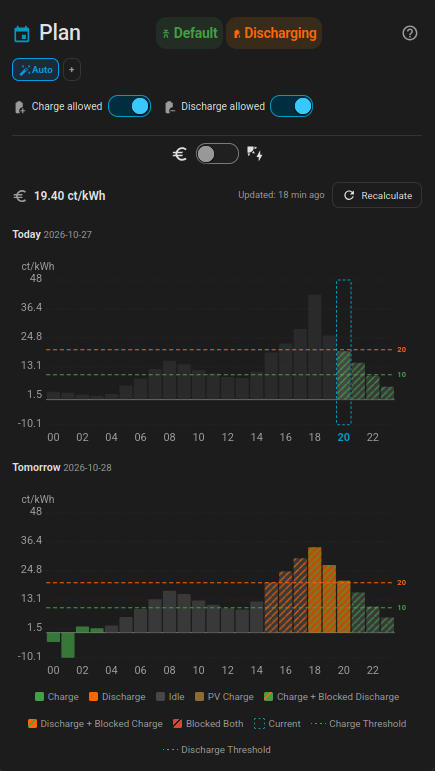
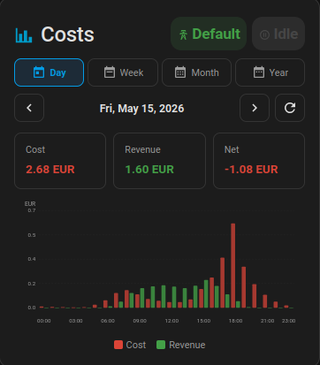
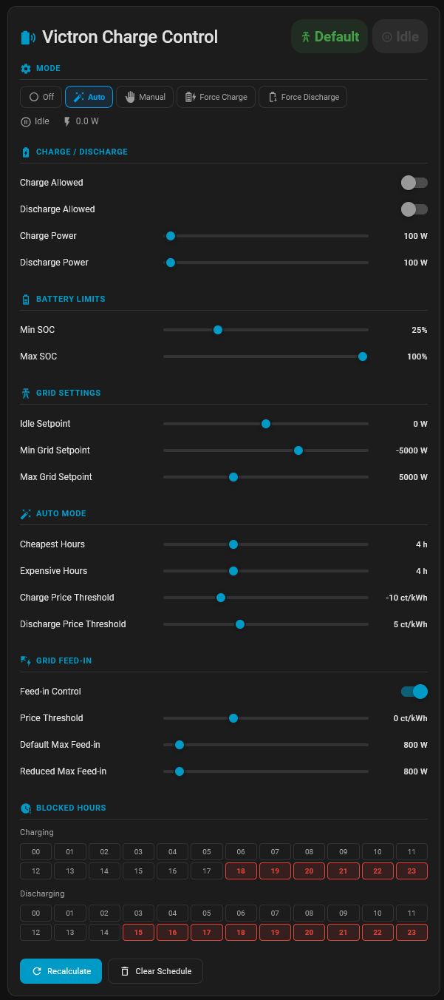
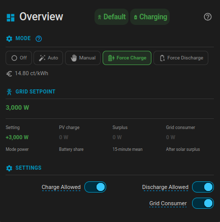

<p align="center">
  
</p>

<h1 align="center">Victron Charge Controller for Home Assistant</h1>

<p align="center">
  <a href="https://github.com/hacs/integration"></a>
  <a href="https://github.com/johannesWen/Victron-Charge-Controller/releases"></a>
  <a href="https://github.com/johannesWen/Victron-Charge-Controller/actions/workflows/ci.yml"></a>
  <a href="https://github.com/johannesWen/Victron-Charge-Controller/blob/main/LICENSE"></a>
  <a href="https://ko-fi.com/yoschi777"></a>
</p>

Victron Charge Controller schedules battery charging and discharging in Home Assistant.
It uses EPEX Spot prices to charge during cheap periods and discharge during expensive periods.
You can also set a schedule or control your Victron ESS from a dashboard or automation.

## Contents

- [Capabilities](#capabilities)
- [Requirements](#requirements)
- [Installation](#installation)
- [Setup](#setup)
- [Dashboard Card](#dashboard-card)
- [Battery Power Control](#battery-power-control)
- [Grid Consumer](#grid-consumer)
- [Battery And Solar Control](#battery-and-solar-control)
- [Disable Discharge](#disable-discharge)
- [Entity Reference](#entity-reference)
- [Services](#services)
- [Defaults](#defaults)
- [Setpoint Convention](#setpoint-convention)
- [Fixed Plans](#fixed-plans)
- [Cost And Energy Tracking](#cost-and-energy-tracking)
- [Development](#development)

## Capabilities

The controller can:

- Choose charge and discharge hours automatically from electricity prices.
- Edit hours for today and tomorrow, or save a daily fixed plan.
- Start charging or discharging with force modes.
- Apply battery charge limits and grid power limits.
- Use spare solar power for charging and export.
- Reduce grid export when prices fall below your chosen limit.
- Account for a large load, such as an electric vehicle charger, with Grid Consumer.
- View Solcast forecasts and track grid energy costs.

Configuration, energy counters, and schedules survive Home Assistant restarts.
Restarting in Auto mode does not replace your saved schedule.

## Requirements

| Component | Purpose |
| --- | --- |
| Home Assistant | Runs the integration and dashboard. |
| Victron GX (Built-in) | Provides battery data and writable power controls. |
| [EPEX Spot](https://github.com/mampfes/ha_epex_spot) | Provides hourly or 15-minute electricity prices for today and tomorrow. |

## Installation

[](https://my.home-assistant.io/redirect/hacs_repository/?owner=johannesWen&repository=Victron-Charge-Controller&category=integration)

To install with HACS:

1. Search for Victron Charge Control in HACS and install it.
2. Restart Home Assistant.
3. Go to Settings → Devices & Services → Add Integration.
4. Search for Victron Charge Control.
5. Select the entities listed below.

## Setup

An entity is a Home Assistant sensor or control.
SOC means battery state of charge, as a percentage.
A setpoint is the power target sent to Victron.
RAM is temporary memory.
PV means power from solar panels.

Select these entities during setup. Leave optional fields empty if you do not use them.

| Field | Required | Purpose or example entity |
| --- | --- | --- |
| Battery SOC sensor | Yes | Battery charge percentage. Example: GX Device - DC battery charge. |
| AC power setpoint | Yes | Permanent idle target in watts. Example: GX Device - AC power setpoint. |
| AC grid setpoint | Yes | Temporary target in watts, stored in RAM. Example: GX Device - AC grid setpoint. |
| EPEX Spot price sensor | Yes | Hourly or 15-minute prices. Example: EPEX Spot Data - Market Price. |
| Max grid feed-in entity | Yes | Writable export limit in watts. Example: GX Device - ESS max feed-in power. |
| Maximum discharge power entity | No | Writable number in W that accepts `0` to prevent battery discharge and `−1` for unlimited discharge. Required for [Disable Discharge](#disable-discharge). |
| Grid consumption energy sensor | No | Total grid import in kWh, for cost tracking. |
| Grid feed-in energy sensor | No | Total grid export in kWh, for revenue tracking. |
| Grid consumer power sensor | No | Load in W or kW, such as an electric vehicle charger. See [Grid Consumer](#grid-consumer). |
| Battery power sensor | No | Battery power in W or kW: positive charging, negative discharging. See [Battery Power Control](#battery-power-control). |
| Solar surplus sensor | No | Spare solar power in watts, for solar charging and export. |
| DC coupled PV feed in switch | No | Controls DC solar export in reduced feed-in mode. Example: GX Device - DC-coupled PV - feed in excess. |

Select different writable number entities for AC power setpoint and AC grid setpoint.
You can change entity selections under Settings → Devices & Services → Victron Charge Control → Configure.
No YAML configuration is needed.

### Upgrade from a version before v2.2.1

The controller cannot start until you select the additional AC grid setpoint entity.
Your existing schedules and configuration remain saved.
To update the configuration:

1. Open Settings → Devices & Services → Victron Charge Control.
2. Open the integration entry menu and select Reconfigure.
3. Keep the existing AC power setpoint selection.
4. Select GX Device - AC grid setpoint for AC grid setpoint.
5. Save the configuration. Home Assistant reloads the integration and retries setup.

### Power targets and connection faults

The permanent AC power setpoint stays at Idle Setpoint.
Active targets use the temporary AC grid setpoint in RAM, refreshed every five seconds.
This includes Grid Consumer adjustments during an Idle action.
Off and safety stops send Idle Setpoint to RAM and stop active refreshes.
The controller retries failed idle writes and attempts an idle reset when the integration unloads.

Setpoint Deadband ignores small changes during normal power updates.
The five-second refresh and safety corrections bypass this limit.
Do not rely on a fixed return time to the permanent target after a connection loss.

Safety watchdog grace period gives sensors time to become available after startup or reload.
It defaults to 90 seconds, accepts 0–600 seconds, and ends early when the required readings are ready.
Set it to `0` to disable this delay.

After this period, missing or unavailable battery SOC or setpoint entities trigger a safety stop and notification.
Unknown SOC or permanent setpoint values also trigger a stop.
An inactive RAM value can be `unknown` and still accept writes.
The notification identifies the failed entities and explains how to resume control.

### Optional Solcast forecast

If [Solcast PV Solar Forecast](https://github.com/BJReplay/ha-solcast-solar) is installed, the controller finds it automatically.
Use Solcast forecast is enabled by default.
You can turn it off under Settings → Devices & Services → Victron Charge Control → Configure.
No extra API key or entity selection is needed.

The controller reads forecasts for today and tomorrow from the local Solcast cache every five minutes.
It makes no extra cloud requests.
Forecasts appear in the Plan card but do not change charging decisions or saved schedules.

Use these sensors to find forecast problems:

| Sensor | Meaning |
| --- | --- |
| Solar Forecast Status | Whether the forecast is ready. See the states below. |
| Solar Forecast Last Updated | The timestamp from Solcast, not the last controller update. |
| Solar Forecast Coverage | Hours of continuous forecast data from now, up to the end of tomorrow. |

| Status | Meaning or action |
| --- | --- |
| `disabled` | Turn on Use Solcast forecast to read forecasts. |
| `not_detected` | If you want forecasts, install and configure Solcast. |
| `unavailable` | Make sure that Solcast loads and provides cached forecasts and an update timestamp. |
| `invalid_data` | Solcast returned invalid forecast data. Make sure that the installed versions are compatible. |
| `incomplete` | Forecast data has gaps before the end of tomorrow. |
| `stale` | The Solcast timestamp is older than 36 hours. Review its update configuration. |
| `ready` | Forecast data covers the remaining time through tomorrow and is no older than 36 hours. |

Forecast failures disable the PV forecast view. They do not trigger the battery safety stop.

## Dashboard Card

The integration loads the dashboard card automatically.
No manual Lovelace resource entry is needed.
In the dashboard editor, select Add Card and search for Victron Charge Controller.

You can also use YAML:

```yaml
type: custom:victron-charge-controller-card
title: Victron Charge Control
entity_prefix: victron_charge_control
view: settings
```

Choose a view in the card editor or with the `view` field:

| View | Purpose |
| --- | --- |
| `overview` | Select the control mode, allow charging or discharging, and see the grid target calculation. |
| `settings` | Adjust power limits, price limits, and other controls. This is the default view. |
| `plan` | View prices, edit the schedule for today and tomorrow, and manage fixed plans. |
| `history` | View grid cost, revenue, import, and export by day, week, month, or year. |

Overview shows how mode power, solar power, Grid Consumer, and signed battery feedback contribute to the grid target.
Zero battery feedback is hidden; older controller calculations without that term remain supported.
When a limit caps the target, the original result appears in parentheses, such as `5,000 W (6,000 W)`.

In the Plan card, switch from Price to PV forecast to view expected solar production.
The chart shows the main Solcast forecast and a lower estimate, alongside electricity price intervals.
The existing EPEX Spot input is detected automatically as 15-minute or 60-minute data; hourly prices stay hourly, and mixed feeds keep their actual intervals without averaging. Price input remains the existing EPEX Spot sensor; no other provider adapter or new resolution setting is added.
In a detected 15-minute feed, entries without `end_time` use the quarter-hour cadence. True hourly periods mixed into that feed require an explicit `end_time`.
It uses the Home Assistant time zone even when your browser uses a different zone. Tooltip and picker times include UTC offsets to distinguish repeated times when daylight saving ends. Spring and fall days retain their actual 23 or 25 hours.

To view or edit an hour:

- Tap or click an hour in Price or PV forecast to show its information. Press and hold or right-click to open its interval picker, or focus the hour and press Enter or Space.
- All available quarters start selected. Deselect any quarters you want to leave unchanged, then choose Charge, PV, Discharge, or Idle to apply only to the selection.
- Past intervals and missing prices are shown disabled; the current partially elapsed quarter stays editable. Reopening the picker selects all available intervals again.
- Hourly feeds show one whole-hour choice. Mixed feeds retain their actual interval bounds. Times include UTC offsets so repeated DST hours can be edited separately.
- Escape, the close button, or clicking outside closes the picker. Each selected interval is saved separately; if a call fails, the picker reports partial results and does not automatically retry.

Both charts fit the full day within the card width. Each hour block contains one hourly bar or four separate 15-minute columns, each with its own action. The whole hour is the chart selection target; quarter choices use full-size buttons in the picker.
Missing prices remain read-only gaps, and past periods cannot be edited. Switch back to Price to edit price limits.
Recurring fixed plans, blocked hours, and recalculation-hour chips remain whole local hours; both occurrences of a repeated hour use those rules.
If Solcast data becomes unusable, the card returns to Price.

| Plan | History |
| :---: | :---: |
|  |  |

| Settings | Overview |
| :---: | :---: |
|  |  |

## Relative Auto Mode

Settings → Auto Mode contains **Relative Auto Mode**, available in every control mode.
It defaults off, preserving absolute price thresholds and duration budgets.
When enabled, the existing price threshold numbers become **Charge Price Delta** and **Discharge Price Delta**, in ct/kWh, with the same entity IDs, values, ranges and steps.
Deltas are signed and may be negative:

- Charge when `price <= price_reference_max - Charge Price Delta`.
- Discharge when `price >= price_reference_min + Discharge Price Delta`.
- Charging wins if both comparisons qualify.

The references are the minimum and maximum of all normalized current and future price intervals, including tomorrow or later, before blocked-hour and PV Charge exclusions.
A negative charge delta places its cutoff above the maximum; a negative discharge delta places its cutoff below the minimum.
Relative selection has no duration cap: Charge Duration and Discharge Duration are disabled in the card, but their saved values remain displayed and are used again when relative mode is off.
Even zero duration permits relative selection; use Charge Allowed and Discharge Allowed to prevent the corresponding action.
Permission switches, SOC protection, recurring blocks, PV Charge exclusions and fixed-plan overrides still apply.

In the Price chart, both days show the same calculated absolute cutoffs using `sensor.<entity_prefix>_charge_plan` attributes `price_reference_min` and `price_reference_max`, in ct/kWh.
Lines are hidden when the corresponding reference is unavailable or the cutoff is outside the chart scale.
Hold and drag a cutoff line to edit its delta; the delta is limited to the existing number entity's range and step before the displayed cutoff is calculated.
Changing relative mode or its reference prices cancels an active drag without saving it.

Reference prices and chart lines can refresh without recalculating the saved schedule: the lines show the current selection cutoffs.
Recalculate, existing Auto-setting changes and configured Recalculation Hours update the schedule; this adds no new recalculation cadence.
Changing Relative Auto Mode recalculates only while the control mode is Auto.
The switch (`switch.<entity_prefix>_relative_auto_mode`), saved duration values and existing schedules survive restart; restoring the switch does not replan.
Cards connected to older installations without this switch show absolute settings and a disabled toggle.

## Battery Power Control

Select the optional **Battery power sensor** (`battery_power_entity`) during integration setup,
or in Settings → Devices & Services → Victron Charge Control → Configure or Reconfigure.
The sensor must report W or kW, with **positive power for charging and negative power for discharging**.
Enable **Battery Power Control** in Overview → Settings or beside the power sliders in Settings → Charge / Discharge.
It defaults off and restores its on/off state after restart. No extra tuning parameters are needed.
The switch exposes `source_entity`, normalized `power_w`, and `feedback_status` attributes
(`disabled`, `inactive`, `waiting`, `active`, or `fallback`).
Without a configured sensor the card disables the toggle and explains how to configure it.

During regular Charge and full Discharge, including Force Charge and Force Discharge,
Charge Power and Discharge Power become desired battery watts while feedback is active.
Feedback does not apply to PV Charge, solar-only discharge at Min SOC, Idle, or Off.
The controller calculates:

`grid target = applied grid watts + desired signed battery watts − measured battery watts`

For example, `3000 W` applied grid, `2000 W` measured battery charging and `3000 W` desired
battery charging request `4000 W` grid. A discharge target uses negative desired battery watts.
Household loads, solar and consumer effects are already reflected in the reading, so active feedback
replaces the existing solar-surplus and Grid Consumer offsets for these actions; they are not added twice.
The overview calculation shows desired signed power as Setting and applied grid minus measured battery
as Battery feedback. Limits account for any clamp on the resulting target.

At startup, the controller uses legacy grid-only control until feedback is ready.
It uses each Home Assistant `last_reported` sample once and waits five seconds for settling after
a changed actuator write. An unchanged RAM keepalive does not restart this settling period.
Invalid, unavailable or stale readings (older than 120 seconds) fall back to grid-only control,
including the existing solar and Grid Consumer offsets. The control's tooltip shows this fallback and when it is
waiting for a baseline or settled reading; feedback recovers automatically when ready.
The configured switch remains turnable off during a sensor outage.

Use a sensor that reports current battery power promptly. The freshness check detects missing
Home Assistant reports, not old measurements repeatedly republished by the source.
Delayed measurements can make the grid target oscillate despite the five-second settling period.

SOC protection, grid setpoint bounds, reduced feed-in limits and device limits still apply.
Actual battery power is not guaranteed to reach the requested target.

## Grid Consumer

Grid Consumer adjusts the power target for a load such as an electric vehicle charger.
Use a sensor for a load already included in Victron ESS consumption.
For several loads, select a sensor that reports their total power.

To enable it:

1. Open the integration configuration.
2. Select Grid consumer power sensor.
3. Turn on Grid Consumer under Settings → Auto Mode in the card.

Grid Consumer defaults to off and remembers its state after a restart.
It works in Auto, Manual, Force Charge, and Force Discharge, including Idle and PV Charge actions.
It does not apply in Off mode. Active Battery Power Control replaces this offset during Charge and full Discharge; other actions and feedback fallback keep the behavior below.

The controller subtracts current solar surplus from the load and adds any remaining demand to the grid target.
It then applies grid and feed-in limits.
Without a valid solar reading, it adds the full load.
With an invalid consumer reading, it removes the adjustment and shows a warning.

For example, a `3,000 W` load with `2,000 W` of solar surplus adds `1,000 W` to the target.
Without solar surplus, a `3,000 W` charging target plus a `3,000 W` load requests `6,000 W`.
The default Max Grid Setpoint caps this at `5,000 W`.
A `−2,000 W` discharge target plus a `3,000 W` load requests `1,000 W` of import before limits.

Load changes take effect after a fixed five-second delay.
Later readings update the value without restarting the delay.
Turning Grid Consumer off, selecting Off mode, or losing a valid load reading removes the adjustment without this delay.

Grid Consumer changes the requested power target. It does not guarantee that the battery will not supply the load.

## Battery And Solar Control

SOC Hysteresis is a buffer that prevents rapid switching at battery limits.
Charging stops at Max SOC and resumes below `Max SOC − SOC Hysteresis`.
Without a solar surplus sensor, discharge stops at Min SOC and resumes above `Min SOC + SOC Hysteresis`.

With a solar surplus sensor, the discharge target includes the average spare solar power over 15 minutes.
Battery protection follows these limits:

| Battery level | Discharge behavior |
| --- | --- |
| Falls to Min SOC | Switch from full discharge to solar-only export. |
| Falls to `max(0, Min SOC − SOC Hysteresis)` or below | Apply Idle Setpoint on the next control update without the normal action delay. |
| Recovers to Min SOC | Resume solar-only export. |
| Rises above `Min SOC + SOC Hysteresis` | Resume full discharge, which can continue down to Min SOC. |

At startup, discharge stays stopped below Min SOC.
With a solar sensor, it starts with solar-only export between Min SOC and the upper limit.
Full discharge starts only above that limit.
With zero hysteresis, discharge stops at or below Min SOC and resumes above it.

The solar average can exceed the power currently available and draw from the battery.
The lower cutoff limits this behavior.
Stopping applies Idle Setpoint. It does not stop other battery activity controlled by Victron.

PV charging shares solar surplus between the battery and grid export.
PV Charging Battery Share sets the battery portion: `100` keeps all surplus, and `0` exports it all.
Grid and feed-in limits still apply.
PV charging requires a solar surplus sensor and follows the maximum SOC limit.
It does not depend on Charge Allowed or blocked charging hours.
Grid Consumer can request grid import during PV Charge or Idle.

## Disable Discharge

Select the optional Maximum discharge power entity in the integration configuration, then enable Disable Discharge in the card's Settings view, directly below Charge Allowed and Discharge Allowed.
The switch defaults off and remembers its state after a restart.
It cannot be enabled without a configured entity; if that external entity becomes unavailable, you can still turn the switch off.

While enabled, the controller writes `0 W` every five seconds throughout regular Charge slots and Force Charge.
This remains active at Max SOC, with Charge Power set to zero, and with Charge Allowed off.
PV Charge is excluded. Existing SOC protection and other charging controls still apply.

Leaving the charging window, turning the switch off, selecting Off mode, or a watchdog stop releases the limit by writing `−1 W` (unlimited).
The previous numerical discharge limit is not restored.
An inactive value reported as `unknown` or null still accepts hold and release writes.
Missing or unavailable entities and failed writes are logged and retried while other controls continue.
Pending cleanup survives restart and reconfiguration, and orderly shutdown attempts to release the limit.
A Home Assistant crash or offline connection can leave the device's persistent limit in place until communication resumes and cleanup succeeds.
Existing settings and schedules remain saved.

## Entity Reference

| Entity | Platform | Description |
| --- | --- | --- |
| Control Mode | Select | `off`, `auto`, `manual`, `force_charge`, or `force_discharge`. |
| Charge Allowed | Switch | Allow charging from the grid. Does not control PV charging. |
| Discharge Allowed | Switch | Allow discharging. |
| Disable Discharge | Switch | Prevent battery discharge during Charge slots and Force Charge. See [Disable Discharge](#disable-discharge). |
| Battery Power Control | Switch | Target measured battery watts during Charge and full Discharge; defaults off and restores after restart. See [Battery Power Control](#battery-power-control). |
| Relative Auto Mode | Switch | Use signed price deltas without duration caps; defaults off and restores without replanning. See [Relative Auto Mode](#relative-auto-mode). |
| Grid Consumer | Switch | Enable the load adjustment described in [Grid Consumer](#grid-consumer). |
| Grid Feed-in Control Enabled | Switch | Enables price-based grid feed-in limiting. |
| Min SOC | Number | Minimum battery charge level. |
| Max SOC | Number | Maximum battery charge level. |
| SOC Hysteresis | Number | Buffer before charging or discharging resumes at a battery limit. |
| Charge Power | Number | Target grid import while charging, or desired battery charging watts with active Battery Power Control. |
| Discharge Power | Number | Discharge power component, or desired battery discharge watts with active Battery Power Control. |
| PV Charging Battery Share | Number | Percentage of spare solar power sent to the battery. |
| Idle Setpoint | Number | Grid setpoint used while idle. |
| Min Grid Setpoint | Number | Lowest allowed grid setpoint. |
| Max Grid Setpoint | Number | Highest allowed grid setpoint. |
| Setpoint Deadband | Number | Minimum change in watts for normal power updates. Set to `0` to disable. |
| Cheapest Hours (Charge Duration in the card) | Number | Absolute Auto charge duration budget in hours, adjustable in 0.25-hour steps; retained but ignored in Relative Auto Mode. |
| Expensive Hours (Discharge Duration in the card) | Number | Absolute Auto discharge duration budget in hours, adjustable in 0.25-hour steps; retained but ignored in Relative Auto Mode. |
| Charge Price Threshold | Number | Absolute maximum charging price, or signed Charge Price Delta below the reference maximum in Relative Auto Mode (ct/kWh). |
| Discharge Price Threshold | Number | Absolute minimum discharging price, or signed Discharge Price Delta above the reference minimum in Relative Auto Mode (ct/kWh). |
| Grid Feed-in Price Threshold | Number | Reduce feed-in when the price falls below this value. |
| Default Max Grid Feed-in | Number | Normal feed-in limit. |
| Reduced Max Grid Feed-in | Number | Export limit when prices are low. Also limits PV Charge and Discharge targets. |
| Blocked Charging Hours | Text | Comma-separated hours excluded from charging. |
| Blocked Discharging Hours | Text | Comma-separated hours excluded from discharging. |
| Active Fixed Plan | Select | Active plan number, or `off`. |
| Recalculate Schedule | Button | Rebuilds the schedule from current price data. |
| Desired Action | Sensor | Current computed action: charge, pv_charge, discharge, or idle. |
| Target Setpoint | Sensor | Current computed grid setpoint in watts. |
| Current Price | Sensor | Current EPEX Spot price. |
| Charge Hours | Sensor | Scheduled charging slots, with dates. |
| Discharge Hours | Sensor | Scheduled discharging slots, with dates. |
| PV Charge Hours | Sensor | Scheduled solar charging slots, with dates. |
| Blocked Charging Hours | Sensor | Active charging block list. |
| Blocked Discharging Hours | Sensor | Active discharging block list. |
| Charge Plan | Sensor | Plan for today and tomorrow; nullable `price_reference_min` and `price_reference_max` attributes hold current/future price extrema in ct/kWh before block/PV exclusions. |
| Fixed Plans | Sensor | Number of saved plans. Attributes contain the plans and active plan number. |
| Last Schedule Update | Sensor | Timestamp of the last schedule calculation. |
| Grid Feed-in Status | Sensor | Current feed-in mode: default or reduced. |
| Grid Energy Cost | Sensor | Total grid energy cost in EUR, before fees and taxes. |
| Grid Energy Revenue | Sensor | Total grid energy revenue in EUR, before fees and taxes. |
| Grid Energy Import | Sensor | Total tracked grid import in kWh. |
| Grid Energy Export | Sensor | Total tracked grid export in kWh. |
| Solar Surplus Mean (15 min) | Sensor | Average spare solar power over 15 minutes, in watts. Requires a solar surplus sensor. |
| Solar Surplus Mode | Sensor | Battery protection stage: `normal`, `solar_only`, or `blocked`. Desired Action shows whether the controller requests discharge. |

## Services

| Service | Description |
| --- | --- |
| `victron_charge_control.toggle_hour` | Cycle a whole local hour (all quarters and both DST occurrences) through `idle`, `charge`, `pv_charge`, `discharge`, `blocked`, and back to `idle`. |
| `victron_charge_control.set_hour_action` | Set a whole local hour to `idle`, `charge`, `pv_charge`, `discharge`, or `blocked`, including all quarters and both occurrences of a repeated DST hour. |
| `victron_charge_control.set_slot_action` | Set one exact current/future priced interval using aware `start_time` and `action`: `idle`, `charge`, `pv_charge`, or `discharge`. Invalid, unpriced, or past targets are rejected without changing the schedule. |
| `victron_charge_control.set_blocked_charging_hours` | Replace the list of charging-blocked hours. |
| `victron_charge_control.set_blocked_discharging_hours` | Replace the list of discharging-blocked hours. |
| `victron_charge_control.set_fixed_plan_hour` | Set a plan hour to `charge`, `pv_charge`, `discharge`, or `idle`. Creates the plan if needed. |
| `victron_charge_control.set_fixed_plan_name` | Set a plan name, up to 10 characters. Creates the plan if needed. An empty value clears the name. |
| `victron_charge_control.add_fixed_plan` | Create a new empty fixed plan. |
| `victron_charge_control.remove_fixed_plan` | Delete a fixed plan (deactivates it first when active). |
| `victron_charge_control.calculate_schedule` | Recalculate the automatic schedule from EPEX Spot prices. |
| `victron_charge_control.clear_schedule` | Clear scheduled and blocked hours. An active fixed plan still applies. |

With Relative Auto Mode off, automatic selection takes whole eligible price intervals without exceeding the duration budget. For example, 1.25 hours can select five quarters from a 15-minute feed; an hourly feed selects one whole hour. The budget spans the available current and future data, rather than guaranteeing a duration each day. Existing entity IDs and saved duration values remain valid.

## Defaults

Change these values through the dashboard or Home Assistant entities.

| Parameter | Default |
| --- | --- |
| Min SOC | 10% |
| Max SOC | 95% |
| SOC Hysteresis | 2% |
| Charge Power | 3000 W |
| Discharge Power | 3000 W |
| Idle Setpoint | 0 W |
| Min Grid Setpoint | -5000 W |
| Max Grid Setpoint | 5000 W |
| Setpoint Deadband | 200 W |
| Relative Auto Mode | Off |
| Cheapest Hours | 4 |
| Expensive Hours | 4 |
| Charge Price Threshold | 10 ct/kWh |
| Discharge Price Threshold | 20 ct/kWh |
| Grid Feed-in Price Threshold | 0 ct/kWh |
| Default Max Grid Feed-in | 5000 W |
| Reduced Max Grid Feed-in | 0 W |
| Blocked Charging Hours | 18-23 |
| Blocked Discharging Hours | 15-17 |

## Setpoint Convention

| Setpoint | Meaning |
| --- | --- |
| Positive, for example `3000 W` | Request power from the grid. |
| Negative, for example `-3000 W` | Request power export to the grid. |
| `0 W` | Request zero net grid power. The battery can still supply local loads. |

## Fixed Plans

Fixed plans repeat the same charge, discharge, and PV-charge hours every day.
Use the second page of the Plan card to create, edit, rename, activate, or delete them.
You can save up to eight plans, with names up to ten characters long.
Only one plan can be active at a time.

The active plan adds hours to today and tomorrow and replaces automatic actions in the same hours.
It applies again after schedule recalculation or plan edits.
Turning it off restores the schedule from before activation.

Fixed plans also supply daily hours in Manual mode after the nightly schedule reset.
A manual change for one date lasts until the next recalculation applies the fixed plan again.

## Cost And Energy Tracking

For cost tracking, select energy sensors that report total grid import and export.
The integration tracks cost and revenue separately:

- Positive prices add grid consumption to cost and grid feed-in to revenue.
- Negative prices add grid consumption to revenue and grid feed-in to cost.
- Taxes, fixed fees, grid fees, and provider markups are not included.

## Development

### Build the bundled card

The card uses Lit and Rollup. Its source is in [`frontend/`](frontend/).
To build it from the repository root, run:

```bash
cd frontend
npm install
npm run build     # -> ../custom_components/victron_charge_control/static/victron-charge-controller-card.js
```

To rebuild the card when a source file changes, run from `frontend/`:

```bash
npm run watch
```

Git ignores the `static/` directory. The release build includes the card in `victron_charge_control.zip`.

### Local Home Assistant

Use the Docker Compose environment to test with dummy Victron and EPEX entities.
From the repository root, run:

```bash
cd frontend && npm install && npm run build && cd ..
docker compose up -d
```

Open <http://localhost:8123>.
For automatic dependency installation, use Dev Containers: Reopen in Container in VS Code.
See [dev/README.md](dev/README.md) for setup, Solcast test data, and sample cost history.
